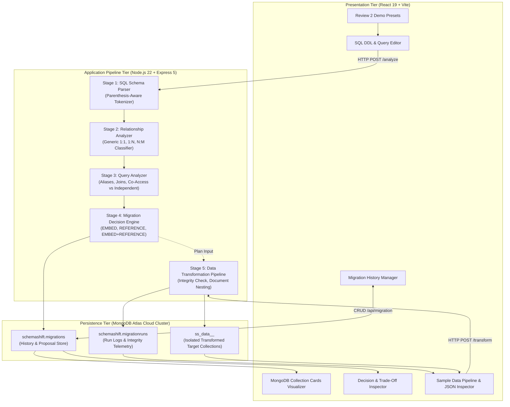

# SchemaShift — Architecture & System Schematics

---

## 1. High-Level System Architecture



---

## 2. The 5-Stage Transformation Pipeline

```
+----------------------------------------------------------------------------------------------------+
|                                    SCHEMASHIFT PIPELINE WORKFLOW                                   |
+----------------------------------------------------------------------------------------------------+

  INPUTS:
  [ 1. Normalized SQL DDL Schema ]            [ 2. Representative SQL Query Workload ]
                 │                                               │
                 ▼                                               ▼
  +─────────────────────────────+                +─────────────────────────────+
  |  STAGE 1: DDL PARSER        |                |  STAGE 3: QUERY ANALYZER    |
  |  • Parenthesis-aware split  |                |  • Strip SQL comments       |
  |  • Extract tables & columns |                |  • Resolve table aliases    |
  |  • Preserve DECIMAL(10,2)   |                |  • Extract join chains      |
  |  • Composite primary keys   |                |  • Co-accessed table pairs  |
  |  • Foreign keys & BSON map  |                |  • Independent table access |
  +──────────────┬──────────────+                +──────────────┬──────────────+
                 │                                              │
                 ▼                                              │
  +─────────────────────────────+                               │
  |  STAGE 2: RELATIONSHIP      |                               │
  |           ANALYZER          |                               │
  |  • Detect 1:N foreign keys  |                               │
  |  • Detect 1:1 (PK or UNIQUE)|                               │
  |  • Detect N:M junction tbls |                               │
  |  • Extract junction attrs   |                               │
  +──────────────┬──────────────+                               │
                 │                                              │
                 └───────────────────────┬──────────────────────┘
                                         ▼
                 +───────────────────────────────────────────────+
                 |  STAGE 4: MIGRATION DECISION ENGINE           |
                 |  • Evaluates relationship + query evidence    |
                 |  • 1:N Co-accessed    ==> EMBED               |
                 |  • 1:N Independent    ==> REFERENCE           |
                 |  • N:M Co-accessed    ==> EMBED + REFERENCE   |
                 |  • Excises child on embed (no duplicates)     |
                 |  • Adds explicit reference metadata           |
                 |  • Generates rationale, trade-offs, limits    |
                 +───────────────────────┬───────────────────────+
                                         │
                                         ▼
                 +───────────────────────────────────────────────+
                 |  STAGE 5: SAMPLE DATA TRANSFORMATION PIPELINE |
                 |  • Ingests JSON sample records by table       |
                 |  • Validates PK / FK referential integrity    |
                 |  • Rejects dangling foreign-key records       |
                 |  • Nests embedded subdocument arrays          |
                 |  • Writes to ss_data_<collection>_<runId>     |
                 +───────────────────────────────────────────────+
```

---

## 3. Decision Matrix for Relationship Transformation

| Relationship Type | Query Workload Pattern | Migration Strategy | Target MongoDB Schema Architecture | Top-Level Collections |
|---|---|---|---|---|
| **1:N** | Parent & Child frequently joined in queries | **EMBED** | Child table embedded as an array of subdocuments inside parent document. Foreign key in child is omitted. | Parent collection only (Child table is excised). |
| **1:N** | Child queried independently without joins | **REFERENCE** | Both Parent and Child remain separate collections. Child collection explicitly retains foreign key reference to parent. | Parent collection, Child collection. |
| **N:M (via Junction Table)** | Queries traverse Parent $\rightarrow$ Junction $\rightarrow$ Related | **EMBED + REFERENCE** | Relationship attributes and reference to related entity embedded into Parent document. Related entity remains independent. | Parent collection, Related entity collection (Junction table excised). |
| **N:M (via Junction Table)** | Junction queried independently | **REFERENCE** | All three tables maintained as normalized collections linked by references. | Table A, Table B, Junction Table. |
| **1:1** | Entities accessed together | **EMBED** | Child entity embedded as a single subdocument object inside parent document. | Parent collection only. |
| **1:1** | Entities accessed independently | **REFERENCE** | Separate collections with explicit foreign key reference in child document. | Parent collection, Child collection. |

---

## 4. Cloud MongoDB Atlas Collection Storage Layout

```
MongoDB Database: "schemashift"
│
├── schemashift.migrations (Persistent System Store)
│   ├── Document 1: { _id, sourceSchema, sampleQueries, generatedSchema, migrationDecisions, createdAt }
│   ├── Document 2: ...
│   └── (Optimized with compound index: { createdAt: -1 })
│
├── schemashift.migrationruns (Telemetry & Audit Store)
│   ├── Document 1: { runId, status, sourceCounts, targetCounts, integrityChecks, collectionsCreated }
│   ├── Document 2: ...
│   └── (Indexed by unique runId)
│
└── Run-Scoped Transformed Target Collections (Isolated Data Store)
    ├── ss_data_customer_run_1760268000000_3a4f1c
    │   ├── Document 1: { _migrationRunId, customer_id: 101, orders: [ { order_id: 5001, amount: 349.5 } ] }
    │   └── Document 2: ...
    ├── ss_data_student_run_1760268100000_8b2e1f
    │   ├── Document 1: { _migrationRunId, student_id: 101, enrollment: [ { course_id: 10, semester: "Fall 2024" } ] }
    │   └── Document 2: ...
    └── ss_data_course_run_1760268100000_8b2e1f
        ├── Document 1: { _migrationRunId, course_id: 10, course_name: "NoSQL Databases" }
        └── Document 2: ...
```
